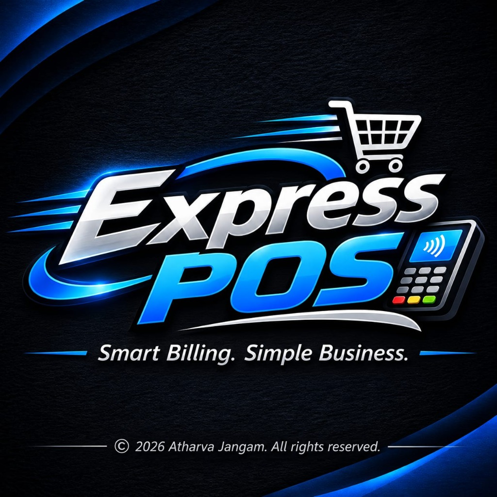

# 🚀 Express POS – Smart Billing. Simple Business.

> **Official Product:** Express POS  
> **Tagline:** Smart Billing. Simple Business.  
> **Author & Copyright:** © 2026 Atharva Jangam. All rights reserved.  
> **Contact / Brand Email:** expresssolution101  
> **Architecture:** Offline-First Progressive Web Application (PWA) with Realtime Cloud Sync

---

## 🌟 Key Features

- **⚡ Offline-First:** Instant billing and collections with zero internet dependency.
- **☁️ Supabase Cloud Sync:** Realtime bidirectional background synchronization when internet is available.
- **🔒 Provider Master Lock:** Database credentials securely locked via stealth 5-tap authorization.
- **📱 1-Click Device Connect:** Instant pairing for new phones, tablets, or computers via QR Code or WhatsApp setup links.
- **🧾 Dual Print Format:** A5 standard invoice with dynamic UPI QR code + 58mm/80mm Thermal Receipt format.
- **💬 WhatsApp Invoicing:** Send itemized bills to customers directly via WhatsApp in 1 click.
- **👥 Multi-Tenant RBAC:** Admin/Owner vs. Cashier/Operator roles with salted SHA-256 password hashing.
- **💸 Expense Management:** Record, edit, rename, and manage daily expenses and custom categories.
- **🌐 Bilingual Engine:** 100% full English ⇄ Marathi dynamic localization.

---

## 🛠️ Tech Stack

- **Frontend:** Vanilla HTML5, CSS3, Modern ES6+ JavaScript.
- **Database Engine:** Supabase (PostgreSQL with PostgREST & Row Level Security).
- **Deployment:** Vercel / Netlify (Zero-configuration static edge delivery).

---

## 📄 License & Ownership

Copyright © 2026 Atharva Jangam. All rights reserved.  
Unauthorized distribution, resale, or white-labeling without explicit authorization is strictly prohibited.

